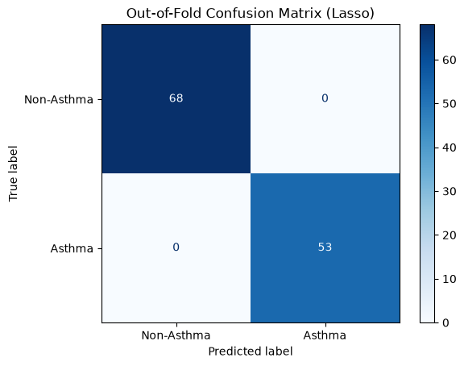

# Exhaled Breathomics for Asthma Classification Using Nested Cross-Validated Logistic Regression

> **Note on Full Methodology:** The complete end-to-end analytical pipeline, step-by-step methodology, and visualizations are documented in the [Primary Analysis Notebook](notebook/breathomics-asthma.ipynb).

## 1. Clinical Background & Objective

Asthma shares respiratory symptoms with bronchiectasis and chronic obstructive pulmonary disease (COPD), including wheezing, dyspnea, and cough. Spirometry supports diagnosis but requires patient cooperation and adequate respiratory effort, which can limit its use in young children and frail older adults.

This project investigates exhaled volatile organic compound (VOC) profiles as a potential non-invasive approach to support differentiating asthma from other inflammatory airway diseases.

The objective is to develop and evaluate regularized logistic regression models to differentiate **asthma from bronchiectasis and COPD** and to identify VOCs repeatedly selected across cross-validation folds.

## 2. Cohort & Clinical Data Pipeline

This project uses *A Clinical Breathomics Dataset* (Kuo et al., 2024), developed by researchers at National Taiwan University. The dataset contains exhaled breath profiles comprising **78 shared VOC features** measured using gas chromatography–mass spectrometry (GC–MS) from **121 patients: 53 with asthma, 35 with bronchiectasis, and 33 with COPD**.

*For details on data exploration, see [Exploratory Data Analysis](notebook/breathomics-asthma.ipynb#Exploratory-Data-Analysis).*

## 3. Methodology & Benchmark Performance

Ridge, Lasso, and ElasticNet logistic regression use VOC features transformed with log1p and standardized within each training fold. Models are evaluated using nested stratified cross validation, with three inner folds for hyperparameter tuning based on ROC AUC and five outer folds for performance evaluation. Tuning covers regularization strength and class weighting, with an additional L1 mixing ratio for ElasticNet.

**Model Comparison.** Performance is summarized as the mean ± standard deviation across the five outer folds.

| Model | ROC-AUC | Accuracy | Precision | Recall | F1 score |
|---|---|---|---|---|---|
| Ridge (L2) | **1.0000 ± 0.0000** | 0.9917 ± 0.0167 | **1.0000 ± 0.0000** | 0.9818 ± 0.0364 | 0.9905 ± 0.0190 |
| Lasso (L1) | **1.0000 ± 0.0000** | **1.0000 ± 0.0000** | **1.0000 ± 0.0000** | **1.0000 ± 0.0000** | **1.0000 ± 0.0000** |
| ElasticNet | **1.0000 ± 0.0000** | 0.9750 ± 0.0333 | **1.0000 ± 0.0000** | 0.9436 ± 0.0737 | 0.9695 ± 0.0403 |

*Detailed evaluation: [Model Building, Results and Evaluation](notebook/breathomics-asthma.ipynb#Model-Building,-Results-and-Evaluation) and [Model Comparison](notebook/breathomics-asthma.ipynb#Model-Comparison).*

## 4. Lasso Logistic Regression and Further Evaluation.

Lasso consistently selects two VOCs across all five outer folds.

| VOC | Mean coefficient | Standard deviation | Association with asthma prediction |
|---|---:|---:|---|
| 2-pentylfuran | 0.985340 | 0.038982 | Positive |
| 2,2,4,4,6,6,8,8,10,10,12,12,14,14-tetradecamethyl-1,3,5,7,9,11,13-heptaoxa-2,4,6,8,10,12,14-heptasilacyclotetradecane | −1.221884 | 0.042673 | Negative |

The confusion matrix summarizes Lasso predictions from the outer validation folds. The model correctly classifies all 53 patients with asthma and all 68 patients with bronchiectasis or COPD.



*Figure 1. Out-of-fold confusion matrix for Lasso logistic regression.*

*Detailed analysis: [Lasso Logistic Regression and Further Evaluation](notebook/breathomics-asthma.ipynb#Lasso-Logistic-Regression-and-Further-Evaluation).*

## 5. End-to-End Workflow & Reproducibility

The analytical workflow proceeds through the following stages:

1. [Import Packages and Load Dataset](notebook/breathomics-asthma.ipynb#Import-Packages-and-Load-Dataset)
2. [Exploratory Data Analysis](notebook/breathomics-asthma.ipynb#Exploratory-Data-Analysis)
3. [Model Building, Results and Evaluation](notebook/breathomics-asthma.ipynb#Model-Building,-Results-and-Evaluation)
4. [Model Comparison](notebook/breathomics-asthma.ipynb#Model-Comparison)
5. [Lasso Logistic Regression and Further Evaluation](notebook/breathomics-asthma.ipynb#Lasso-Logistic-Regression-and-Further-Evaluation)

From the repository root, install the required Python packages and launch the analysis:

```bash
python3 -m pip install -r requirements.txt
python3 -m notebook notebook/breathomics-asthma.ipynb
```

Keep the supplied CSV and Excel files in `data/` and run cells sequentially from the top.

---

**Full workflow:** The complete step-by-step analytical workflow, code, and visualizations are documented in the companion [Primary Analysis Notebook](notebook/breathomics-asthma.ipynb).
